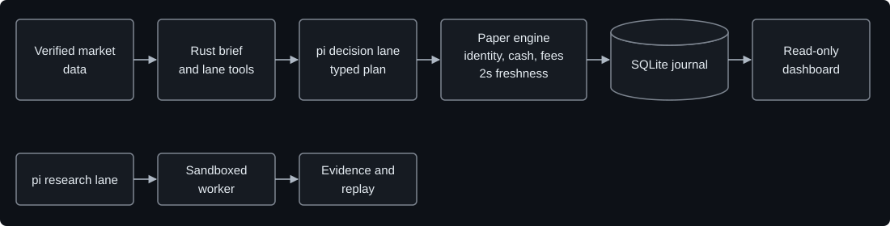

# Nivra

**Agent-led paper trading and research for Indian markets.**

[](https://github.com/TharunChougoni/nivra/actions/workflows/ci.yml)
[](rust-toolchain.toml)

Nivra is an experimental Rust workspace for paper-only trading and research on
Indian markets. A pi decision lane receives a factual, verified market brief and
returns a typed paper TradePlan. Deterministic code owns identity, cash, fees,
fills and protection, and rejects any action that cannot be supported by an
original quote receipt no more than two seconds old.

> **Experimental and paper-only.** Live orders and live activation are disabled.
> This is not investment advice, a profitability claim, or a production trading
> system. Source, CI, artifacts and host operation are separate facts: a passing
> build or install does not qualify a host or authorize a session.

## Scope

- **Paper execution:** NSE cash equities/ETFs and a bounded, buy-only Nifty
  weekly option-long mandate. Full F&O metadata and contract chains are
  display-only. Futures, stock options, short options and live orders are not
  executable.
- **Models:** pi owns the decision, research, and review sessions and their
  provider calls. Rust builds the briefs and validates every paper action.
- **Sources:** Upstox v3 market data/history and NSE BOD/contract metadata
  adapters.
- **Research lane:** registered, hash-pinned jobs run in an owned
  bubblewrap/systemd sandbox. Results are evidence, never orders or automatic
  promotions.
- **Dashboard:** authenticated, read-only React/TypeScript workspace. It has no
  trading controls.
- **Credentials:** none ship with the repository. Use only application-owned
  broker/model credentials; do not import another application's auth cache.

## Architecture



The trading and research lanes are independent. A research result cannot place,
size or promote a trade. The shared financial engine is also used by offline
replay, so after-cost results and cross-session evidence use the same fill and
fee path as the paper controller.

## Why the engineering is interesting

- **Typed financial domain.** Exact decimal cash/fees, instrument and calendar
  validation, and separate cash and option mandates in Rust.
- **Deterministic paper fills.** Original quote receipts, adverse tick rounding,
  cash/held-unit checks, and no ambiguous retry or broker failover.
- **Model-led, code-checked decisions.** A factual brief and typed action
  contract keep model output away from credentials, cash arithmetic and fill
  authority.
- **Independent lanes with typed budgets.** Trading and research have separate
  workers, journals, allowances and failure records.
- **Frozen candidate artifacts.** Hash-pinned inputs, owned process sandbox, no
  network scorer, leases and cancellation proof.
- **Shared-engine replay.** After-cost replay and cross-session evidence reuse
  the runtime fee/fill engine.
- **Read-only dashboard.** Authenticated React/TypeScript UI with bounded
  projections and no order controls.
- **Guarded delivery.** CI checks, deterministic musl assembly, immutable tags
  and a guarded updater.

## Safety trade-offs

- A fill requires an original quote receipt at most **two seconds** old; archived
  receipt time is never replaced by a later clock sample.
- Ambiguous orders are not retried or failed over to another broker. An ACK is
  not a fill.
- Live orders and live activation are disabled.
- Research does not automatically promote a strategy, change policy, or
  authorize a session.
- Paper fills are simulations, not broker fills, and do not establish
  profitability.

## Getting started

Requirements: Linux x86_64 and Rust **1.95.0** (pinned by `rust-toolchain.toml`).
Node **22.19+** runs the pi agent subprocess the paper controller uses for model
turns; Node **24** builds the dashboard sources. The committed dashboard bundle
needs no Node runtime. Add the `x86_64-unknown-linux-musl` target only to reproduce
release artifacts.

```sh
git clone https://github.com/TharunChougoni/nivra.git
cd nivra
cargo build --workspace --all-targets --locked
target/debug/nivra --help
target/debug/nivra self-check
```

These commands are offline checks and do not start a paper session. Guarded
releases are published from this repository when explicitly requested;
installing one never authorizes a session. The retired `ind-sadr` repository is
no longer a deployment source.

- [Configure a paper installation](packaging/rust/CONFIGURATION.md)
- [Read the documentation index](docs/README.md)
- [Review the architecture](docs/ARCHITECTURE.md)

Research/sandbox features additionally require Linux with `bubblewrap` and a
systemd user manager. A successful Cargo build does not qualify a host for those
features.

## Documentation

| Guide | What it covers |
| --- | --- |
| [Architecture](docs/ARCHITECTURE.md) | Crates, runtime flow, durable state and lane boundaries |
| [Operations](docs/OPERATIONS.md) | Configuration, startup, recovery and operator safety procedures |
| [Strategy](docs/STRATEGY.md) | Paper mandate, execution gates, fees and Nifty option scope |
| [Lane tools](docs/LANE_TOOLS.md) | Lane triggers, tool boundary, plan binding, evidence and budgets |
| [Dashboard](docs/DASHBOARD.md) | Read-only API, React workspace and captured-data projections |
| [Testing](docs/TESTING.md) | Behavioral test strategy and current gate |
| [Development](docs/DEVELOPMENT.md) | Build, release workflow and immutable-tag policy |

See the [documentation index](docs/README.md) for setup, replay, market feed,
research worker and strategy-sandbox references.

## Repository layout

| Crate | Responsibility |
| --- | --- |
| `nivra-core` | Decimal finance, fees, instruments/calendar, quotes, paper execution and replay |
| `nivra-store` | SQLite ledger, durable control/read journals, writer bindings |
| `nivra-cli` | Paper controller, scanner, pi agent lanes, history, dashboard, recovery and updater |
| `nivra-research` | Registered jobs, leases, sandbox worker and result contracts |
| `nivra-sandbox` | CLI-free scorer/replay containment API |
| `nivra-tools` | Release assembly/checks, streaming replay and repository checks |

Start reading at `rust/nivra-cli/src/main.rs`,
`rust/nivra-cli/src/runtime/wide/controller.rs`,
`rust/nivra-core/src/execution.rs` and `rust/nivra-core/src/finance.rs`. The
dashboard source is under `rust/nivra-cli/src/runtime/web/v2/src/`.

## Current gate

The local gate is formatting, an all-targets build, strict Clippy, the Rust test
suite, release-link checks and the dashboard tests. Current facts, not permanent
performance claims:

- At most **400** Rust test functions, including ignored tests.
- **2** frozen golden files.
- Dashboard behavior, type and source/bundle hash checks.

See [Testing](docs/TESTING.md) and [Development](docs/DEVELOPMENT.md) for
commands. CI runs the Rust and dashboard checks; a tagged commit can build the
musl artifacts.
