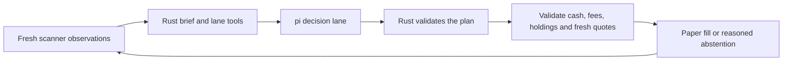

# Continuous discovery and off-market paper replay

Paper only. The live-order path remains disabled. Model allowances are operational
settings, not position, loss, exposure or holding-period caps.

## Continuous flow



Each scan cycle feeds Rust's deterministic trigger engine. A fill, position risk,
a persistent top-ranked candidate or a scheduled/pre-close turn wakes the decision
lane; triggers that arrive while a turn runs merge into the next batch. Rust
builds the bounded brief, publishes the lane tools and reserves the paper claim.
Pi runs the turn and returns its final TradePlan; only a completed turn with a
final validated proposal can reach the paper plan head. Deterministic execution
rechecks the original quote receipt and the two-second fill gate before any fill.
See [pi agent lanes](AGENT.md) for the lanes, tools and settings.

A pi research lane answers the decision lane's `research` requests, and each
completed answer is delivered in a later decision brief. A review lane runs once
after the session seal; its redacted text becomes the review memory the next
session carries. The live controller starts no digest or persistent orchestrator
turn.

Lane cadence and evidence eligibility live in `planner.agent.triggers`: top-K
persistence, per-instrument cooldown, entry score, held-position proximity and
adverse-move thresholds, the pre-close minute, and the research quiet/drift
settings. A merged batch runs under its highest-priority trigger. `model/agent/`
holds the trigger journal, turn archive, usage ledger and lane sessions. Pi
reports usage per turn; Rust charges it to the lane's daily call and cost
allowance, including an in-flight turn cut off by a crash. Lowering a cap never
refunds a charge or replaces a journal.

The dashboard shows actual prospects and fresh/stale/unseen counts. Movement
between irregular retained bid samples is an observation priority, not a profit
estimate or executable quote. The unknown first sample time is explicit.

## Full-day offline test

Replay constructs no provider client, reads no credential and starts no service
or pi lane. It replays explicit recorded or scripted model replies through the
retained Rust planner backend under a virtual clock, with the runtime scanner
projection, factual digest production, event journal, protection and fee engine.
The offline driver settles digests as deferred owner work; it does not run the
persistent owner, create owner plans or start pi. The replay's `--planner` file
therefore needs a digest-enabled legacy planner config; a pi paper planner refuses
at digest production. Every run requires a new private output directory with an explicitly
identified simulation book. It never copies or resets an original session's usage
authority.

```sh
nivra paper-replay-demo --output /tmp/paper-day-inputs
nivra paper-replay \
  --manifest /tmp/paper-day-inputs/manifest.json \
  --events /tmp/paper-day-inputs/events.jsonl \
  --planner /tmp/paper-day-inputs/planner.json \
  --responses /tmp/paper-day-inputs/responses.json \
  --output /tmp/paper-day-result
```

The labelled synthetic 09:15–15:30 demo has 376 quote events and 375 deferred
factual digests, with no owner calls or fills. These are protocol results, not
measured model intelligence or profitability. `report.json` includes fills,
fees, capital reconciliation, request/allowance counts and coverage. A timeout
fixture verifies no fill and no book halt.

## Genuine quote archives

```sh
nivra paper-replay-export \
  --source-session /path/to/original/session \
  --capital PAPER_CAPITAL --max-gap-ms 60000 \
  --history /path/to/validated/history \
  --output /path/to/new/quote-export
```

This opens the source SQLite database read-only. It retains original source,
receipt, availability and processing timestamps, validates instrument mapping,
and hashes exported events and original quote rows. New captures retain scanner
versus execution/protection purpose; only screen events update scanner evidence.
Legacy captures lack purpose: the exporter explicitly counts them as
`legacy_quote_purpose_unknown` and re-screens them. Such exports cannot reproduce
the exact original scan schedule. Account payloads, credentials
and read quotas are not exported. Supply the exported manifest/events, an explicit
planner and a response transcript to `paper-replay`.

## Archive fill reconciliation

`nivra strategy-lab reconcile-archive --manifest capture-manifest.json
--events capture-events.jsonl --fills fills.json --output new-report.json`
recomputes fees from the configured paper cost schedule, compares recorded fill
prices with adverse tick-aware execution against the last executable quote at or
before each fill, tracks cash and partial exits, and reports residual holdings.
Net P&L and marked equity are present only when the tape is flat; leftover
positions and missing quotes stay unknown rather than estimated. Observation
gaps larger than the manifest `max_observation_gap_ms` are listed, not filled.
The command does not construct a model client or alter the source archive.

The fills file is `{"version":1,"capital":"...","costs":{...},"fills":[...]}`
using the shared fill object. If both the file and the paper manifest include
`paper_costs`, they must match.

The offline replay responses file is an array of
`{"role":"digest","latency_ms":integer,"output":JSON-or-string}`. Each reply must
match the factual owner-digest schema. Model latency consumes virtual time;
protection continues on intervening observations. Missing/exhausted responses are
reported, never replaced by a fallback strategy. Pi lanes are not involved in
offline replay.

The manifest's `max_observation_gap_ms` declares coverage tolerance. Reports
separate open/close window coverage from gaps inside that window. Partial archives
remain partial. Daily/minute OHLC bars cannot supply missing bid/ask receipts and
are never substituted for executable quotes. Snapshot tools return only archived
quotes available by virtual time and still within two seconds; otherwise unavailable.
Future observations, rewritten receipts, invalid grids, altered event hashes and
unknown instruments refuse.

These tests validate software behaviour. Genuine subscription-model behaviour and
market data completeness remain separate operating evidence. Future work is
tracked in [GitHub Issues](https://github.com/TharunChougoni/nivra/issues).

Replay manifests require an explicit `paper_costs` policy. Export preserves the
source book's recorded policy when present; exports from older books without one
must be supplied a reviewed policy before replay. The
synthetic demo includes the sample paper policy.
