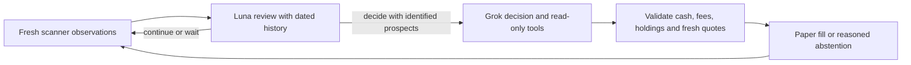

# Continuous discovery and off-market paper replay

Paper only. The live-order path remains disabled. Model allowances are operational
settings, not position, loss, exposure or holding-period caps.

> This guide covers the legacy Luna-to-Grok replay/archive flow retained for
> offline replay and historical compatibility. The current runtime uses the
> reviewed decision-owner policy: Luna compiles a factual digest and one
> persistent orchestrator owns paper decisions. See the
> [model harness](MODEL_HARNESS.md#decision-owner-migration-policy).

## Continuous flow



Each changed scanner batch records an event. A configured cooldown coalesces work;
it does not force trades. Every admitted discovery cycle calls Luna afresh, with
the preceding Luna review, latest accepted Grok decision, current cash/positions,
timestamped prospects and full dated historical features. A successful morning
digest is not reused for subsequent discovery cycles.

Luna adds this handoff to its usual digest JSON:

```json
{"handoff":{"decision":"continue","instrument_keys":[],"reason":"Wait for new evidence"}}
```

`continue` and `wait` finish an advisory review and wait for another scanner
observation; they are recorded as `deferred`, not failed or a Grok decision.
`decide` must identify allowlisted prospects and passes the new digest/evidence
to Grok. There is no fixed number of Luna reviews before this handoff. Luna has
read-only historical-feature and quote tools; Grok owns buy/sell/hold/abstain.
Each accepted Grok result reaches an execution observation before admission of
a successor. Quote receipt times and the two-second fill gate remain unchanged.

Example planner fields, merged with existing role/credential settings:

```json
{
  "require_digest": true,
  "context": {"mode": "tools_only"},
  "tools": {"scanner_limit": 40, "ranking_limit": 50, "history_limit": 5,
            "max_instrument_keys": 20},
  "discovery": {"max_scan_age_ms": 180000, "max_prospects": 10000,
                "scan_batch_size": 200, "scan_interval_ms": 8000},
  "digest": {"daily_call_budget": 5000, "budget_unit": "event",
             "max_turns": 64, "max_read_tools": 256, "timeout_ms": 120000},
  "decide": {"daily_call_budget": 500, "budget_unit": "event",
             "max_turns": 64, "max_read_tools": 256, "minimum_turn_ms": 30000,
             "timeout_ms": 150000, "run_timeout_ms": 600000},
  "events": {"cooldown_ms": 10000, "decision_timeout_ms": 900000}
}
```

`tools_only` is the default and sends Luna only a trigger envelope; Grok receives
only the trigger and Luna's validated digest/handoff. Use
`"context":{"mode":"projection","universe_rows":150}` with
`full_universe_features:true` only for the v2 rollback message shape.

Under a reviewed owner policy, `discovery.digest_cadence_ms` (default 60000,
allowed 1000–3600000) admits a factual digest after that gap since the last
admitted digest. A due material or held-position event takes precedence. An
eligible cadence digest whose canonical facts signature is unchanged does not
wake the orchestrator, while a material event always does; an ineligible digest
never supersedes pending work. The owner schema and prompt are described in
[model harness](MODEL_HARNESS.md#decision-owner-migration-policy).

Settings are validated at load. Daily allowances have no compiled 1000-call
ceiling. Tool turns sharing an event consume one logical role allowance; every
actual provider request retains its own immutable reservation/result. Usage journal
capacity/read bounds derive from configured budgets/turns, with optional
`usage_max_records` and `usage_manifest_max_bytes` overrides. Original inode pins,
history checks and consumed charges still apply. Lowering a cap never refunds a
charge or replaces a journal. Legacy omitted fields retain compatible defaults.

The dashboard shows actual prospects and fresh/stale/unseen counts. Movement
between irregular retained bid samples is an observation priority, not a profit
estimate or executable quote. The unknown first sample time is explicit.

## Full-day offline test

Replay constructs no provider client, reads no credential and starts no service.
It uses explicit recorded/scripted model responses and the runtime scanner
projection, Luna handoff, harness, event journal, plan validation, paper fills,
protection and fee engine under a virtual clock. Every run requires a new private
output directory with an explicitly identified simulation book. It never copies
or resets an original session's usage authority.

```sh
sadr-rs paper-replay-demo --output /tmp/paper-day-inputs
sadr-rs paper-replay \
  --manifest /tmp/paper-day-inputs/manifest.json \
  --events /tmp/paper-day-inputs/events.jsonl \
  --planner /tmp/paper-day-inputs/planner.json \
  --responses /tmp/paper-day-inputs/responses.json \
  --output /tmp/paper-day-result
```

The labelled synthetic 09:15–15:30 demo has 376 quote events, 375 Luna reviews,
two Luna-selected Grok handoffs and a buy/sell pair. These are protocol results,
not measured model intelligence or profitability. `report.json` includes fills,
fees, capital reconciliation, request/allowance counts and coverage. A timeout
fixture verifies no fill and no book halt.

## Genuine quote archives

```sh
sadr-rs paper-replay-export \
  --source-session /path/to/original/session \
  --capital PAPER_CAPITAL --max-gap-ms 60000 \
  --history /path/to/validated/history \
  --output /path/to/new/quote-export
```

This opens the source SQLite database read-only. It retains original source,
receipt, availability and processing timestamps, validates instrument mapping,
and hashes exported events and original quote rows. New captures retain scanner
versus execution/protection purpose; only screen events update scanner evidence.
Legacy captures lack purpose: the exporter explicitly counts them as
`legacy_quote_purpose_unknown` and re-screens them. Such exports cannot reproduce
the exact original scan schedule. Account payloads, credentials
and read quotas are not exported. Supply the exported manifest/events, an explicit
planner and a response transcript to `paper-replay`.

## Archive fill reconciliation

`sadr-rs strategy-lab reconcile-archive --manifest capture-manifest.json
--events capture-events.jsonl --fills fills.json --output new-report.json`
recomputes fees from the configured paper cost schedule, compares recorded fill
prices with adverse tick-aware execution against the last executable quote at or
before each fill, tracks cash and partial exits, and reports residual holdings.
Net P&L and marked equity are present only when the tape is flat; leftover
positions and missing quotes stay unknown rather than estimated. Observation
gaps larger than the manifest `max_observation_gap_ms` are listed, not filled.
The command does not construct a model client or alter the source archive.

The fills file is `{"version":1,"capital":"...","costs":{...},"fills":[...]}`
using the shared fill object. If both the file and the paper manifest include
`paper_costs`, they must match.

The transcript is an array of `{"role":"digest"|"decide","latency_ms":integer,
"output":JSON-or-string}`. Each reply must match the next requested role. Model
latency consumes virtual time; protection continues on intervening observations.
Missing/exhausted responses are reported, never replaced by a fallback strategy.

The manifest's `max_observation_gap_ms` declares coverage tolerance. Reports
separate open/close window coverage from gaps inside that window. Partial archives
remain partial. Daily/minute OHLC bars cannot supply missing bid/ask receipts and
are never substituted for executable quotes. Snapshot tools return only archived
quotes available by virtual time and still within two seconds; otherwise unavailable.
Future observations, rewritten receipts, invalid grids, altered event hashes and
unknown instruments refuse.

These tests validate software behaviour. Genuine subscription-model behaviour and
market data completeness remain separate operating evidence. Future work is
tracked in [GitHub Issues](https://github.com/TharunChougoni/nivra/issues).

Replay manifests require an explicit `paper_costs` policy. Export preserves the
source book's recorded policy when present; exports from older books without one
must be supplied a reviewed policy before replay. The
synthetic demo includes the sample paper policy.
