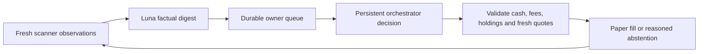

# Continuous discovery and off-market paper replay

Paper only. The live-order path remains disabled. Model allowances are operational
settings, not position, loss, exposure or holding-period caps.

## Continuous flow



Each changed scanner batch records an event. A configured cooldown coalesces work;
it does not force trades. Each eligible discovery cycle calls Luna afresh with
current evidence and dated history. Luna returns factual coverage, gaps and a
bounded brief. The persistent orchestrator owns buy, sell, hold and abstain
decisions. Luna has no handoff field or decision veto.

The controller commits the validated digest and its durable owner work together.
The owner binds each decision to the current portfolio, policy, model and session
revisions. Deterministic execution rechecks the original quote receipt and the
two-second fill gate before any fill. See the
[model harness](MODEL_HARNESS.md#owner-policy-and-ledger-authority) for the
owner schema, prerequisites and authority checks.

`discovery.digest_cadence_ms` (default 60000, allowed 1000–3600000) admits a factual
digest after that gap since the last admitted digest. A due material or
held-position event takes precedence. An eligible cadence digest whose canonical
facts signature is unchanged does not wake the orchestrator, while a material
event does. An ineligible digest never supersedes pending work.

Settings are validated at load. Daily allowances have no compiled 1000-call
ceiling. Tool turns sharing an event consume one logical role allowance; every
actual provider request retains its own immutable reservation/result. Usage journal
capacity/read bounds derive from configured budgets/turns, with optional
`usage_max_records` and `usage_manifest_max_bytes` overrides. Original inode pins,
history checks and consumed charges still apply. Lowering a cap never refunds a
charge or replaces a journal. Legacy omitted fields retain compatible defaults.

The dashboard shows actual prospects and fresh/stale/unseen counts. Movement
between irregular retained bid samples is an observation priority, not a profit
estimate or executable quote. The unknown first sample time is explicit.

## Full-day offline test

Replay constructs no provider client, reads no credential and starts no service.
It uses explicit recorded or scripted digest responses and the runtime scanner
projection, factual digest harness, event journal, protection and fee engine under
a virtual clock. The offline driver settles digests as deferred owner work; it
does not run the persistent orchestrator or create owner plans. Every run requires
a new private output directory with an explicitly identified simulation book. It never copies
or resets an original session's usage authority.

```sh
nivra paper-replay-demo --output /tmp/paper-day-inputs
nivra paper-replay \
  --manifest /tmp/paper-day-inputs/manifest.json \
  --events /tmp/paper-day-inputs/events.jsonl \
  --planner /tmp/paper-day-inputs/planner.json \
  --responses /tmp/paper-day-inputs/responses.json \
  --output /tmp/paper-day-result
```

The labelled synthetic 09:15–15:30 demo has 376 quote events and 375 deferred
factual digests, with no owner calls or fills. These are protocol results, not
measured model intelligence or profitability. `report.json` includes fills,
fees, capital reconciliation, request/allowance counts and coverage. A timeout
fixture verifies no fill and no book halt.

## Genuine quote archives

```sh
nivra paper-replay-export \
  --source-session /path/to/original/session \
  --capital PAPER_CAPITAL --max-gap-ms 60000 \
  --history /path/to/validated/history \
  --output /path/to/new/quote-export
```

This opens the source SQLite database read-only. It retains original source,
receipt, availability and processing timestamps, validates instrument mapping,
and hashes exported events and original quote rows. New captures retain scanner
versus execution/protection purpose; only screen events update scanner evidence.
Legacy captures lack purpose: the exporter explicitly counts them as
`legacy_quote_purpose_unknown` and re-screens them. Such exports cannot reproduce
the exact original scan schedule. Account payloads, credentials
and read quotas are not exported. Supply the exported manifest/events, an explicit
planner and a response transcript to `paper-replay`.

## Archive fill reconciliation

`nivra strategy-lab reconcile-archive --manifest capture-manifest.json
--events capture-events.jsonl --fills fills.json --output new-report.json`
recomputes fees from the configured paper cost schedule, compares recorded fill
prices with adverse tick-aware execution against the last executable quote at or
before each fill, tracks cash and partial exits, and reports residual holdings.
Net P&L and marked equity are present only when the tape is flat; leftover
positions and missing quotes stay unknown rather than estimated. Observation
gaps larger than the manifest `max_observation_gap_ms` are listed, not filled.
The command does not construct a model client or alter the source archive.

The fills file is `{"version":1,"capital":"...","costs":{...},"fills":[...]}`
using the shared fill object. If both the file and the paper manifest include
`paper_costs`, they must match.

The transcript is an array of `{"role":"digest","latency_ms":integer,
"output":JSON-or-string}`. Each reply must match the factual owner-digest schema. Model
latency consumes virtual time; protection continues on intervening observations.
Missing/exhausted responses are reported, never replaced by a fallback strategy.

The manifest's `max_observation_gap_ms` declares coverage tolerance. Reports
separate open/close window coverage from gaps inside that window. Partial archives
remain partial. Daily/minute OHLC bars cannot supply missing bid/ask receipts and
are never substituted for executable quotes. Snapshot tools return only archived
quotes available by virtual time and still within two seconds; otherwise unavailable.
Future observations, rewritten receipts, invalid grids, altered event hashes and
unknown instruments refuse.

These tests validate software behaviour. Genuine subscription-model behaviour and
market data completeness remain separate operating evidence. Future work is
tracked in [GitHub Issues](https://github.com/TharunChougoni/nivra/issues).

Replay manifests require an explicit `paper_costs` policy. Export preserves the
source book's recorded policy when present; exports from older books without one
must be supplied a reviewed policy before replay. The
synthetic demo includes the sample paper policy.
